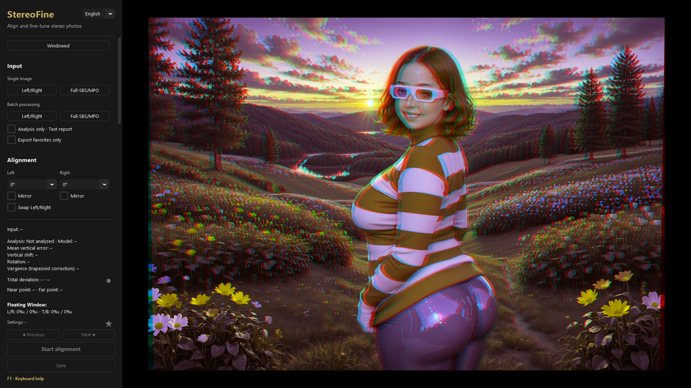
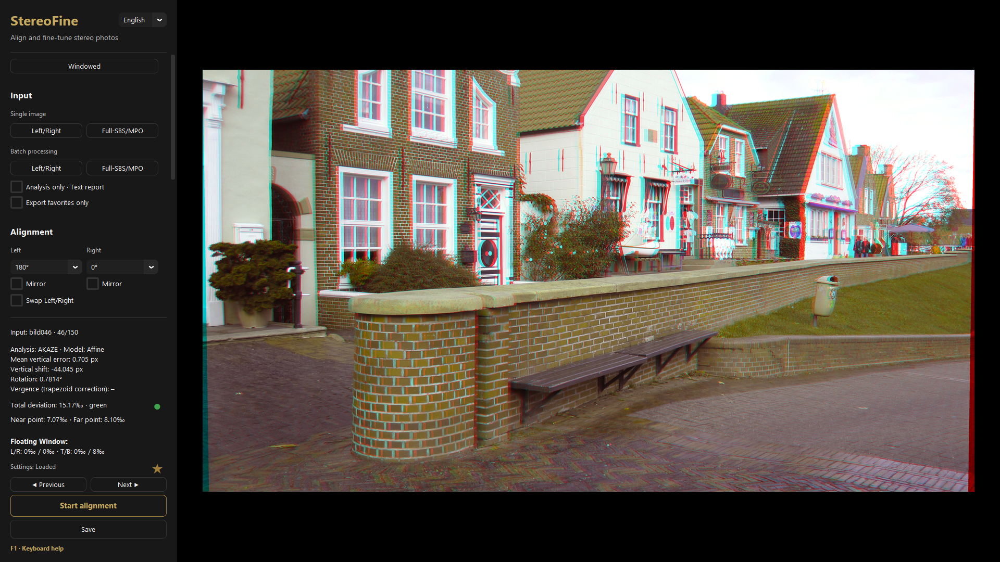
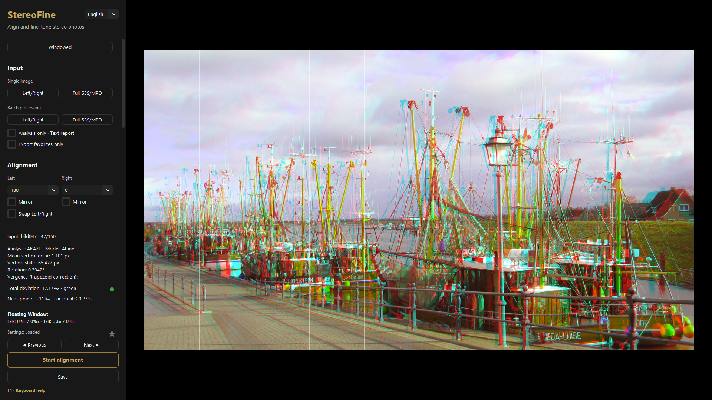
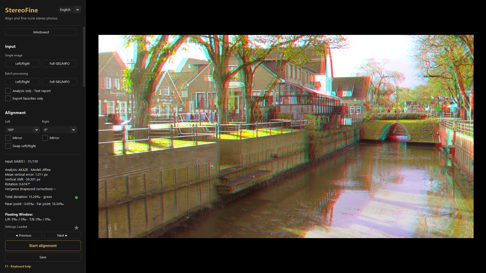

# StereoFine 1.4

[Downloads and SHA-256](https://github.com/muelli1975/StereoFine/releases/tag/v1.4) · [Deutsch](README_DE.md) · [Changes](RELEASE_NOTES_1.4.md)

**Version 1.4.** Straighten the horizon and correct vertical perspective with `H`. StereoFine retains inspection zoom after realignment, prepares neighbouring previews in the background and can analyse several pairs at once in a batch. Exposure is adjustable from −2 to +2 EV.

**Version 1.3:** Mouse and keyboard view zoom, near/far markers, a two-click disparity meter, and 50 LUT looks in six groups with custom .cube/HaldCLUT .png import and adjustable strength.

**Version 1.2:** Optional lossless TIFF SBS export retains 8 or 16 bits per channel automatically. Hold **Z** for a native 100% view; pan with the arrow keys, accelerating when held and release **Z** to return. Preview and output use the same final-crop colour matching. Failed sidecar writes retain your edits and prevent export with old settings.

**Output and preview:** Grayscale anaglyphs and Save cross-view are saved independently from the preview under Image and output. Cross-view exports the finished full-colour R/L pair in `cross` as JPEG quality 90 with 4:4:4 sampling. **A** cycles Color, Grayscale and Cross-view previews; **M** temporarily uses the last anaglyph preview. Crop, crop zoom and crop movement automatically refresh deviation without changing alignment or stereo-window framing. The status shows “Calculating …” while this measurement is pending. Each launch starts with the Color anaglyph preview.

Version 1.1 improves automatic model selection, vertical edge correction and near/far measurement. It adds JPS/PNS, static WebP/BMP and supported SDR HEIC/HEIF input, including compatible stereo and Spatial Photo containers. Ambiguous depth measurements remain explicitly marked as uncertain. See [measurement validation](docs/OBSERVED_RANGE_1.1.md) and [input-format scope](docs/IMAGE_FORMATS_1.1.md).

StereoFine is a local desktop tool for automatically aligning, checking, framing and exporting stereoscopic image pairs. It is designed to do as much reliable work automatically as possible without taking manual control away from the user. The interface therefore stays deliberately compact and keyboard-friendly.

StereoFine works completely locally: no account, no cloud, no tracking and no automatic downloads during use.

  

## Downloads

| Platform | Archive |
| --- | --- |
| Windows x64 | [StereoFine_1.4_Windows_x64.zip](https://github.com/muelli1975/StereoFine/releases/download/v1.4/StereoFine_1.4_Windows_x64.zip) |
| Linux x64 | [StereoFine_1.4_Linux_x64.tar.gz](https://github.com/muelli1975/StereoFine/releases/download/v1.4/StereoFine_1.4_Linux_x64.tar.gz) |
| macOS Apple Silicon | [StereoFine_1.4_macOS_AppleSilicon.zip](https://github.com/muelli1975/StereoFine/releases/download/v1.4/StereoFine_1.4_macOS_AppleSilicon.zip) |
| macOS Intel | [StereoFine_1.4_macOS_Intel.zip](https://github.com/muelli1975/StereoFine/releases/download/v1.4/StereoFine_1.4_macOS_Intel.zip) |

[SHA-256 checksums](https://github.com/muelli1975/StereoFine/releases/download/v1.4/SHA256SUMS.txt). Extract the entire archive before starting the application. On macOS open `StereoFine.app`; on Linux start `StereoFine`.

The Windows package is portable:

1. Download [StereoFine_1.4_Windows_x64.zip](https://github.com/muelli1975/StereoFine/releases/download/v1.4/StereoFine_1.4_Windows_x64.zip) and extract the complete archive into a normal writable folder.
2. Open the extracted `StereoFine` folder and start `StereoFine.exe`.
3. Keep the application folder together; `tools`, `_internal` and the other supplied files belong to the application.

Version and architecture appear in the ZIP filename. The application folder is `StereoFine` and the executable is `StereoFine.exe`, without a version or architecture suffix.

The [previous 1.0 release](https://github.com/muelli1975/StereoFine/releases/tag/v1.0) remains available. Extract updates into a separate folder and retain your settings and saved image adjustments.

The portable version does not require a separate Python installation. Global settings are stored as `settings.json` next to `StereoFine.exe`.

## macOS and Linux builds

The same source can also be packaged for macOS (Apple Silicon and Intel) and Linux x64. GitHub Actions builds these variants from the tagged source. Windows is the reference platform; macOS/Linux binaries should be treated as platform builds pending a real desktop smoke test on those systems. No stereo, geometry or color-processing code differs between platforms. The native detail view has GUI scaling checks from 100 to 200%; physical Retina backing-pixel mapping on macOS still needs a real-display check. The platform packages include ExifTool for metadata handling; on macOS/Linux the official ExifTool distribution is Perl-based and therefore expects a working Perl interpreter on the target system. If metadata copying is unavailable, StereoFine keeps the successfully written image and reports a non-fatal warning.

## Quick start

1. Use **Left/Right** to select one image from a stereo pair, or **Full-SBS/MPO** to open a stereo file.
2. Choose **Start alignment**. StereoFine analyzes the geometry, determines near point, far point and total deviation, and frames the detected near point slightly behind the stereo window by default.
3. Check the result in the anaglyph preview and fine-tune it with the keyboard if required.
4. Choose **Save**. StereoFine writes an SBS JPEG or, with **SBS as TIFF (lossless)** enabled, an SBS TIFF. **Save anaglyphs** additionally writes one anaglyph and is enabled by default. The indented **Grayscale anaglyphs** checkbox selects its appearance independently of the preview; its choice is retained while saving anaglyphs is off.

Choosing **Start alignment** again recalculates geometry and near-point framing, clears manual horizontal/vertical nudges, and keeps the selected crop, aspect ratio and crop position. The detected near point is framed at least 3‰ behind the stereo window when a measurement is available. Saving and batch processing retain saved fine adjustments.

The same processing core is available for complete folders through batch processing.

## Screenshots

  
  
  

## Supported input

Officially supported:

- JPEG/JPG, including JPS
- PNG, including PNS
- TIFF/TIF
- static WebP and BMP
- SDR HEIC/HEIF, including tagged stereo and Spatial Photos
- MPO
- Full-SBS in the supported still-image containers
- separate Left/Right pairs using `*_l` / `*_r`
- separate pairs in `l` and `r` subfolders

JPS/PNS use the existing JPEG/PNG readers. Open packed images through **Full-SBS/MPO** and verify the eye assignment; use **Swap L/R** when required. The extension does not automatically choose a layout or eye order. Other arrangements such as Over/Under are not added by this extension.

Open tagged stereo HEIF through **Full-SBS/MPO**; the container’s stereo group determines the eyes. Untagged files use only the primary image, interpreted as Full-SBS through that entry point, or as one eye in a separate Left/Right pair. HDR, ambiguous stereo groups, unequal HEIF eye sizes and unsupported SDR colour descriptions are rejected. HEIF with an ICC profile is converted to sRGB; sRGB/unspecified SDR is accepted without an additional converter. The new HEIF/WebP/BMP paths use 8-bit RGB and discard alpha like the existing PNG path; animated WebP is rejected. Convert RAW to JPEG, PNG or TIFF first.

16-bit PNG and 16-bit TIFF are not reduced to 8 bit immediately when loaded. StereoFine creates separate 8-bit proxies for feature/disparity analysis and preview. Final JPEG output is deliberately 8 bit.

## Automatic alignment

StereoFine uses a conservative model hierarchy:

- **AKAZE** is the fast default feature method.
- **SIFT** is available as a slower manual alternative.
- A symmetric affine correction handles vertical shift, rotation and relative scale differences.
- A controlled **Vergence/Trapezoid correction** is accepted only when it actually performs better than the simpler model on independent validation points.
- **Y-Polish** can correct remaining vertical residuals, but is likewise used only when it provides a measurable additional benefit.

Geometry analysis uses a maximum width of 3000 px. All selected geometric corrections — affine alignment, Vergence/Trapezoid correction and Y-Polish — are composed into a single mapping. Each half-image is then resampled only once with high-quality Lanczos interpolation, avoiding cumulative interpolation loss from a chain of successive warps.

## Deviation, near point and far point

After geometric correction, StereoFine runs a separate semi-dense horizontal disparity analysis at up to 1500 px width. The baseline uses robust P1/P99 limits and additional checks for uncertainty. Eligible uncertain far estimates receive native endpoint confirmation at both 1500 and 1000 px. A smaller observed span retains an uncertainty warning because scene completeness is unproven. See [the admission rule and validation](docs/OBSERVED_RANGE_1.1.md).

New automatic analyses apply the 3‰ stereo-window back reserve to the final half-image width after overlap, aspect-ratio cropping and crop zoom. Integer-pixel rounding and the independent final measurement can yield near-point values other than −3‰. Existing saved framing and manual edits are retained; Start recalculates automatic framing.

Automatic stereo-window framing is followed by a measurement of the finished selected crop. The displayed deviation and confidence refer to that crop. Earlier saved pre-framing measurements are refreshed without changing saved framing or fine adjustments. Manual alignment nudges retain the measured span and translate its endpoints; aspect, crop zoom and crop movement trigger a new measurement.

The width limits apply per eye. Additional point checks compare local 17x17 brightness windows in the analysis image; native near-point recovery and conditional two-ended confirmation use 41x41 windows at original spatial resolution. These are measurement neighbourhoods, not independently warped image tiles or export crops. The [measurement-window guide](docs/MEASUREMENT_WINDOWS_1.1.md) explains these checks and separates them from the larger-window research pilot.

The traffic light is practical guidance:

- **green:** up to 33‰ total deviation
- **orange:** above 33‰ up to 40‰
- **red:** above 40‰
- **gray:** measurement unavailable or considered uncertain

These colors are a working aid, not a hard physiological boundary.

### Automatic near-point framing

When the analysis is reliable, StereoFine shifts the pair horizontally so that the detected near point lies at least **3‰ behind the stereo window** by default. Pixel rounding may place it slightly farther back.

`Ctrl+R` restores exactly this automatic state: automatic alignment including the 3‰ near-point framing. Later manual adjustments are discarded.

## Floating Window

Floating Window masks provide a convenient way to correct stereo-window violations without changing the depth or parallax of the scene itself. Adjustable side masks and tilted masks at the top or bottom can bring the perceived stereo-window edge forward where needed — especially when foreground objects intersect an image border. StereoFine lets these masks be adjusted directly in the preview and applies them consistently to the final stereo output.

Left, right, top and bottom values are stored per image in the `.sfin` sidecar.

## Symmetric color matching

New installations start with the Original aspect ratio and symmetric color matching enabled. Saved preferences and per-image adjustments retain their chosen values. Color matching can be switched off at any time. It does not force one eye to match the other. Instead, robust percentile curves move both half-images toward a shared target state. It remains completely outside geometry and deviation analysis.

Pairs that already match well should remain practically unchanged. The function can be enabled or disabled at any time.

## `.sfin` sidecars

StereoFine stores the reproducible state of an image pair in a small `.sfin` file inside the `_stereofine` subfolder of the input folder. It contains only technically useful state and parameters, including:

- source and validity fingerprint
- automatic correction and analysis basis
- deviation, near point and far point
- automatic near-point framing
- manual X/Y adjustment
- crop and aspect ratio
- Floating Window
- color matching
- favorite state

The analysis report shows the values needed for stereoscopic quality control. Additional analysis and uncertainty details are stored in the sidecar. A valid sidecar can be reused in later batch runs. Changed source files or relevant pipeline versions invalidate only the calculations that need to be recomputed.

## Batch processing

StereoFine can automatically process separate pairs or folders containing Full-SBS/MPO files. Single-image and batch work use the same core.

### Analysis only · Text report

StereoFine analyzes the complete folder, creates or updates sidecars and writes `stereofine_analysis.txt`. No SBS or anaglyph images are exported.

The report is a compact aligned text table containing only file, traffic light, total deviation, near point, far point, mean vertical error, vergence and rotation. The note “Estimate uncertain – please check!” is added only when the disparity estimate is genuinely uncertain.

### Export favorites only

A practical review workflow is:

1. Browse a folder in StereoFine.
2. Fine-tune individual pairs when necessary and mark favorites.
3. Later run the complete folder with **Export favorites only** enabled.

Saved `.sfin` states are reused. Non-favorites may still be analyzed, but produce no image output.

## Output and folders

Image exports write:

- an SBS JPEG, quality 95, or a losslessly compressed SBS TIFF when selected
- one color or grayscale anaglyph JPEG, quality 90, when **Save anaglyphs** is enabled

TIFF keeps 8-bit sources at 8 bits per channel and 16-bit sources at 16 bits. A mixed pair is promoted to 16 bits before processing. TIFF retains the common working ICC profile; JPEGs and the preview use sRGB. Untagged RGB is treated as sRGB. The TIFF setting is remembered and applies to single images and batches. Existing outputs of another format remain in place. Cross-view remains JPEG quality 90 with 4:4:4 sampling.

Anaglyphs are reduced to a maximum height of 2160 px when needed. Color anaglyph output uses proper sRGB linearization.

By default StereoFine creates an `output` folder inside the input folder. Alternatively, a persistent custom output folder can be selected. Finished images and analysis reports are first written completely to temporary files and only then atomically replaced at their final paths.

Existing image outputs with the same name are deliberately replaced.

**Custom SBS suffix** enables an editable list: `_s` (m.objects), `_cs` (COSIMA), `-lr` (Bino), no suffix, or your own text. The field defaults to COSIMA (`_cs`). When the checkbox is off, the standard `_sbs` suffix is used. The choice replaces `_sbs` immediately before `.jpg` or `.tif`; program labels are shown only in the list. Deviation numbers precede the chosen suffix, for example `photo_030_s.jpg`. These preferences apply to single-image and batch exports and are remembered. Existing files are not renamed or deleted when export preferences change.

**Deviation in filename** optionally adds the measured total deviation in whole
permille: for example, `photo_057_sbs.jpg` and `photo_057_anaglyph.jpg`. Values are
rounded to the nearest whole permille and padded to at least three digits. This
option is off by default and remembered between sessions. The filename uses only
the number, including for uncertain estimates. Uncertainty remains indicated in
the application and analysis report. No number is added when a current measurement is unavailable.

## Metadata

Where possible, StereoFine copies metadata using the bundled ExifTool. Preview, Orientation and MPF/MPO container metadata are not copied into ordinary SBS/anaglyph JPEG files. If only metadata copying fails, a successfully written image remains valid and StereoFine shows a warning.

## Controls

### Navigation

- `Page Up` / `Page Down` – previous / next image
- `Space` – start alignment or batch
- `Enter` – save current image
- `F` – toggle favorite

### Manual alignment

- Arrow keys – shift horizontally/vertically by 1 px
- `Shift` + Arrow – 5 px
- `Ctrl` + Arrow – 10 px
- `Ctrl+R` – reset manual edits and realign if a horizon or perspective correction was removed
- `H` – correct horizon and perspective. Use `←/→` for the horizon and `↑/↓` for perspective. `Enter` applies the correction and realigns the pair. `Esc` discards the draft.

### Crop

- `Alt` + Arrow – move crop
- `Ctrl+Shift+↑/↓` – crop zoom

### Floating Window

- `S` – link/separate Left/Right
- hold `L`, `R`, `T` or `B` + `←/→` – change the selected edge by 1‰

### Preview

- `A` – cycle Color, Grayscale and Cross-view previews
- `X` – switch between cross-view and the last anaglyph preview
- `G` – cycle grid
- `Shift+G` – grid off
- hold `Z` – native 100% view; `Z` + Arrow keys pans with fine taps and smooth acceleration when held, like the measurement cross
- hold `M` – show measurement cross
- `M` + Arrow keys – move measurement cross
- `F11` – fullscreen
- `D` – toggle near/far points (also under Preview)
- `Ctrl` + Mouse wheel – view zoom around the pointer
- `Ctrl+Plus/Minus` – keyboard view zoom
- Middle-button drag – pan magnified view
- `Ctrl+0` or double-click the magnified view - fit image
- Right click – context menu with disparity meter, in anaglyph previews only
- Two left clicks in measurement mode – set start and end
- `F1` – Controls guide
- `Esc` - close the menu, help or measurement mode first, then fit a magnified view, then leave fullscreen

## Exposure and LUT looks

**Exposure** adjusts both eyes of the current pair by −2 to +2 EV. Hold **Shift** while scrolling over the slider to adjust exposure or LUT strength. Hold **C** and use **Left/Right** to cycle through LUTs or **Up/Down** to adjust LUT strength in five-percentage-point steps.

Below symmetric colour matching, **Apply LUT** enables the selected look. Strength ranges from 0 to 100%. **Import (.cube, .png)** loads a custom 3D Cube file or square 8/16-bit HaldCLUT PNG. The per-image `.sfin` stores selection, strength and the custom file path; custom LUT files must remain available at that path. Both eyes receive the same look, before floating-window masks and anaglyph conversion.

Hover over a look to preview it, click to apply it, or press Esc to keep the previous selection. Use Cross-view to judge colours. Enable the corresponding checkbox to use the LUT or the custom SBS suffix.

**Apply to folder…** lists the input folder and the number of recognised stereo images. Select any combination of aspect ratio, LUT including strength, symmetric colour matching and exposure. StereoFine writes those choices to the image settings files. The dialog shows progress, and cancelling keeps completed updates. Individual image settings take precedence over program defaults. Missing settings follow the current defaults.

Under **Alignment**, **Save as folder orientation** stores the current image's rotation, mirroring and eye order as the folder default in `_stereofine/orientation.json`. An image with its own orientation keeps it.

Without a saved folder default, browsing to an image without its own orientation uses the orientation of the last displayed image in the same folder. Batch processing uses the current image's orientation as that fallback.

View zoom only changes the preview. Crop zoom determines the exported image area. N/F labels use the same values and formatting as the status display. The markers show the corresponding image evidence, with a question mark when its location is uncertain. View and measurement annotations stay in the preview.

Look sources and terms: [CREDITS](assets/luts/CREDITS.md).

## Settings and language

**Restore defaults**, below the preview options, resets program options while retaining the language, selected output destination and destination mode, and dialog locations. Use `Ctrl+R` to reset manual image corrections.

Global preferences are stored in `settings.json` next to the portable application. Image-specific state belongs exclusively in `.sfin`.

Diagnostic messages are stored in `logs/stereofine.log` with two rotated copies and a 2 MiB limit per file. StereoFine clears its diagnostic log files older than 30 days on startup.

**Analysis only** and **Export favorites only** are job modes and are not stored as persistent preferences.

The GUI can be switched between German and English. StereoFine terms such as Affine, Vergence, Y-Polish and Deviation remain technically consistent.

## Source and build

The published portable folder contains the exact source used to build `StereoFine.exe` under `Source/`. The same source is intended for the public GitHub repository.

Build instructions are in [BUILD_WINDOWS.md](BUILD_WINDOWS.md). Historical validated analysis baselines are documented in [docs/VALIDATION.md](docs/VALIDATION.md).

## License

StereoFine source code and original documentation created by Christoph Müller are released under the **MIT License**. Third-party components remain explicitly under their respective licenses.

See `LICENSE.txt`, `THIRD_PARTY_NOTICES.md` and `licenses/`.
